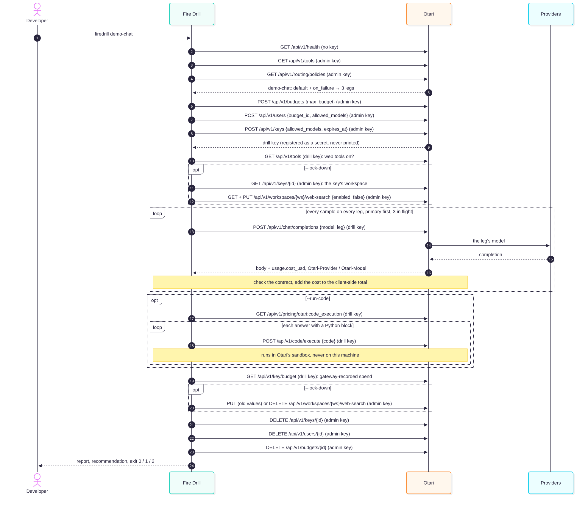

# Fire Drill

**Rehearse your Otari fallback routes before an outage does it for you.**

An [Otari](https://github.com/mozilla-ai/otari) routing policy puts several models
behind one model name: failover chains, budget tier-downs, weighted splits. The backup
legs only run when the primary fails or a budget cap fires, which means in production,
on the worst day. Fire Drill sends your real requests down every leg ahead of time and
tells you which legs would break your app.

## 30-second quickstart

You need a running Otari, its master key and Node 20+.

```bash
docker compose up -d                       # in your Otari checkout
export OTARI_BASE_URL=http://localhost:8000
export OTARI_ADMIN_KEY=<your master key>   # OTARI_MASTER_KEY in Otari's .env
npx otari-firedrill init && npx otari-firedrill <policy-name>
```

`init` writes `samples.jsonl` with three generic requests (one JSON schema, one tool
call, one plain text). Replace them with real request bodies from your app for a real
answer. Until the package is on npm, run it from a clone: `npm ci && npm install -g .`, then
`firedrill init && firedrill <policy-name>`.

## What a drill looks like

A real run against a local Otari with three real models behind `demo-chat`
(`demo/run-demo.sh` sets this up):

```text
$ firedrill demo-chat --samples demo/samples.jsonl --budget 0.10
Drilling "demo-chat" on http://localhost:8000: 1. openrouter:openai/gpt-4o-mini  2. openrouter:google/gemma-3-12b-it  3. openrouter:mistralai/mistral-small-3.2-24b-instruct

Fire Drill: "demo-chat"  5 samples x 3 legs x 1 run

#  Role        Model                                        Pass       Failures            p50     $/req     $/1k
1  primary     openrouter:openai/gpt-4o-mini                5/5 100%   -                  1.2s $0.000026  $0.0256
2  failover 1  openrouter:google/gemma-3-12b-it             4/5 80%    tool 1             1.1s $0.000010  $0.0100
3  failover 2  openrouter:…/mistral-small-3.2-24b-instruct  5/5 100%   -                 818ms $0.000011  $0.0112

Failures
  leg 2  sample 4  tool  "get_weather" arguments break its schema: missing "unit"
      "{"city": "Lag{}"}"

! Web search or fetch is enabled in this workspace. Replays never attach web tools, but your app's real requests might.

Spent $0.000234 of $0.10 (gateway recorded $0.000234). Drill key revoked. 6.3s.
Leg 2 fails 1/5 tool-call checks. Move it below leg 3 or remove it.
$ echo $?
1
```

Gemma 3 12B passed every JSON-schema sample but sent `get_weather` a broken `city` and
no `unit` (it did so on every one of 30+ tries while this demo was built). If the primary went
down, every weather question would have failed. Exit codes: `0` all legs at or above
`--fail-under`, `1` a leg below it, `2` the drill could not run.

## How it works





The diagrams' sources and a table of every gateway call, its credential and its cost
are in [docs/architecture.md](docs/architecture.md). `--trace` prints the same calls as
they happen.

1. **Preflight.** `GET /api/v1/health`, then `GET /api/v1/tools`, which also proves the
   key works. Every failure names its cause and the fix.
2. **Resolve legs.** Reads the policy with `GET /api/v1/routing/policies` and turns its
   spec into ordered legs: `primary` (the default), `weighted n` / `priority n` (router
   pools), `tier-down n` (budget conditions), `conditional n`, then `failover n`
   (`on_failure`). Without the admin key, pass `--legs a,b,c` or `--config <config.yml>`.
3. **Mint a drill key.** A budget, a user and an API key just for this run: budget =
   `--budget`, model allow-list = the legs, expiry of 10 to 60 minutes.
4. **Load samples.** Each line must be a chat-completion body. `model`, `stream`, `user`
   and non-function tools are removed, and secrets and emails are redacted before
   anything is sent, printed or written.
5. **Derive the contract** from each request, with no tests to write:

   | The request has | A leg must |
   | --- | --- |
   | `response_format: json_schema` | return bare JSON that validates against the schema (ajv) |
   | `response_format: json_object` | return a JSON object |
   | `tools` | call a listed tool with arguments that validate against its parameters, when the primary called one |
   | neither | return non-empty text, not cut off (`finish_reason: length`), and not refuse where the primary answered |
   | always | answer HTTP 200 from the model it was asked for (`Otari-Provider` / `Otari-Model` headers) |

6. **Replay.** Every sample down every leg on the drill key, primary first, 3 at a time,
   60 s timeout, one retry on 429/5xx.
7. **Report.** Pass rate, failures by check, median latency, cost per request and per
   1,000 requests, each failure with a redacted excerpt, and one recommendation.
8. **Revoke** the key, the user and the budget, always.

## How each Otari feature is used

| Otari feature | What Fire Drill does with it |
| --- | --- |
| **Routing policies** | Reads `GET /api/v1/routing/policies` (master key) and drills every candidate, including config-file policies. |
| **Virtual keys** | Mints a per-run key with `POST /api/v1/keys`: model allow-list = the legs, `expires_at` minutes away. Deletes it with `DELETE /api/v1/keys/{id}`. |
| **Budgets** | `POST /api/v1/budgets` with `max_budget` = `--budget`, attached to a per-run user (`POST /api/v1/users`). The gateway refuses past the cap with `403 budget_exceeded`. |
| **Usage tracking** | Reads cost from `usage.cost_usd` on every response, falls back to `GET /api/v1/usage/requests/{id}`, and checks the total against `GET /api/v1/key/budget`. Every replay is tagged in `metadata` (`firedrill_run`, `firedrill_leg`, `firedrill_sample`), so the drill is filterable on Otari's Overview. |
| **Built-in tools** | `GET /api/v1/tools` in preflight; warns when the drill key's workspace has web search or fetch on. |
| **Served-model headers** | `Otari-Provider` and `Otari-Model` prove which model answered, since the body keeps the requested name. |

## Safety model

Enforced in code and covered by tests:

- **Keys are never printed.** Keys come from flags or env only. Every key Fire Drill is
  given or mints is registered and scrubbed from all output, errors and stack traces,
  even when the gateway echoes one back (`test/integration.test.ts`, "secrets").
- **The drill key is always revoked:** in a `finally`, on SIGINT and SIGTERM, and on an
  uncaught crash. Revoking deletes the key, then deletes the user (which also disables
  any key it holds), then deletes the budget. If revocation fails, the exit code is `2`
  and the exact `curl` to finish it is printed (tests: "on SIGINT", "on SIGTERM",
  "exits 2 and still revokes").
- **Budget is enforced twice:** by Otari on the drill key's budget, and by a
  client-side running total that reserves an estimate before each request and stops
  before the cap.
- **No web tools on replays.** Only `function` tools are sent; gateway web tools, MCP
  servers and provider-native tools are stripped from samples.
- **No local execution of model output:** no `eval`, no `child_process`, no `vm`. ESLint
  rules in `eslint.config.js` fail the build if `src/` imports them.
- **No telemetry.** The only network calls go to `--gateway`, with redirects refused so a
  key cannot follow one to another host.
- **Files are private.** Samples written by `init` are `0600`, and `.gitignore` covers
  samples and reports.

## Options

```text
firedrill <alias> [options]
  --gateway <url>        default $OTARI_BASE_URL or http://localhost:8000
  --key <key>            default $OTARI_API_KEY (never printed)
  --admin-key <key>      default $OTARI_ADMIN_KEY (reads the policy, mints the drill key)
  --samples <file>       JSONL of chat-completion request bodies (default samples.jsonl)
  --budget <usd>         hard cap for the whole drill, default 0.50
  --runs <n>             replays per sample per leg, default 1
  --legs <a,b,c>         use these legs instead of reading the policy
  --config <file>        read the policy from an Otari config.yml
  --workspace <id>       pick the workspace when a policy name exists in several
  --fail-under <pct>     exit 1 if any leg's pass rate is below this, default 100
  --use-existing-key     run on --key instead of minting (client-side budget only)
  --concurrency <n>      requests in flight, default 3
  --timeout <seconds>    per-request timeout, default 60
  --trace                print each gateway call: step, method, path, status, latency,
                         cost and which credential signed it (never its value)
firedrill init [--samples <file>] [--force]
```

## Run it in CI when the routing config changes

```yaml
# .github/workflows/fire-drill.yml
name: Fire drill
on:
  pull_request:
    paths: ["otari/config.yml", "fire-drill/samples.jsonl"]
jobs:
  drill:
    runs-on: ubuntu-latest
    steps:
      - uses: actions/checkout@v4
      - uses: actions/setup-node@v4
        with: { node-version: 22 }
      - name: Drill every leg of the "chat" policy
        env:
          OTARI_BASE_URL: ${{ secrets.OTARI_STAGING_URL }}
          OTARI_ADMIN_KEY: ${{ secrets.OTARI_STAGING_MASTER_KEY }}
        run: npx otari-firedrill chat --samples fire-drill/samples.jsonl --budget 0.25 --fail-under 100
```

The job fails (exit 1) when a leg breaks a contract, and its log shows which leg and
why. Point it at a staging gateway whose `config.yml` matches the change under review.

## The demo

`demo/run-demo.sh` starts Otari with Postgres and the code sandbox, creates the
`demo-chat` policy above and runs the drill. All three legs are real models reached
through OpenRouter, so it needs `OPENROUTER_API_KEY`. `demo/reset.sh` returns the stack
to a clean state.

`demo/fake-leg/` is a small OpenAI-compatible stub that always answers in prose. It is
**not** used unless you set `FIREDRILL_DEMO_FAKE=1`, a fallback for the day Gemma stops
failing. If you use it, say so: it is registered in Otari as the named provider
`drillfake`, not a real model.

## Limitations

- **A drill calls each leg directly**, because Otari has no header that forces a policy
  onto one candidate. So the policy's mandatory guardrails are not applied, and
  `reasoning_effort` is sent to every leg (inside a policy, Otari drops it for models
  that do not reason). JSON schema and tool behaviour reproduce faithfully.
- **Chat Completions only**, not streamed. Messages and Responses requests are not replayed.
- **Only `function` tools** are checked; multi-turn tool loops are replayed as recorded.
- **Contracts are structural.** A leg that returns valid but wrong JSON passes.
- **Refusal detection is a heuristic** (the `refusal` field plus common phrasings).
- **The drill key's expiry is capped at 60 minutes**, so very large drills can outlive it.
- **Costs** are only as good as Otari's pricing for each model. An unpriced model is
  refused by Otari (`pricing_required`) and shows up as a failing leg.

## Roadmap

- Replay Messages and Responses requests, and streamed responses.
- Semantic checks: compare each leg's answer with the primary's, beyond structure.
- A pass-through recorder that writes samples from live traffic.
- Read policies through the organization routes for teams without the master key.

## Development

```bash
npm ci
npm run check        # typecheck, lint, build, tests
FIREDRILL_LIVE=1 OTARI_ADMIN_KEY=... FIREDRILL_LIVE_ALIAS=demo-chat npm run test:live
```

`NOTES.md` records how each Otari API used here was confirmed, with file and line
references into Otari's source.

## License

MIT
