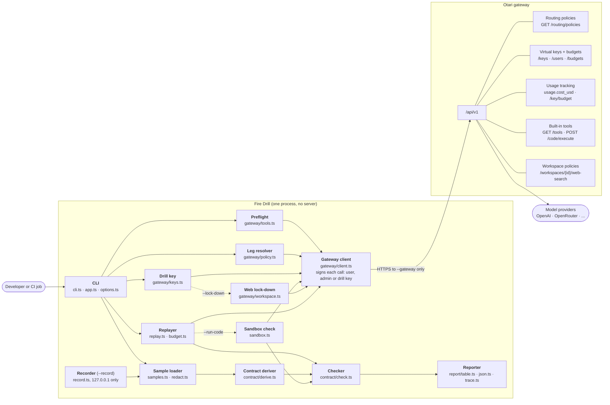
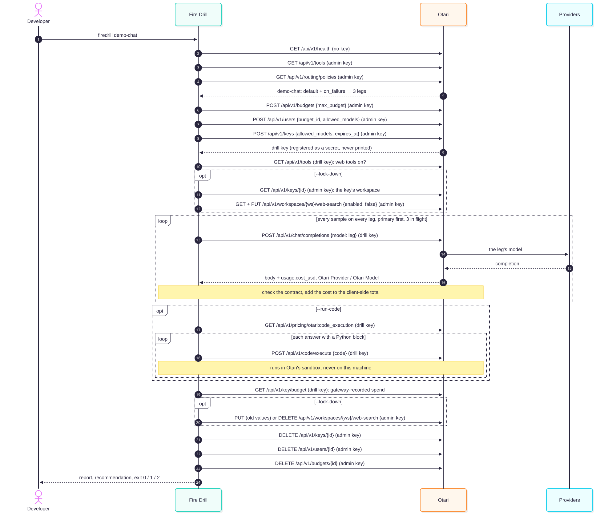
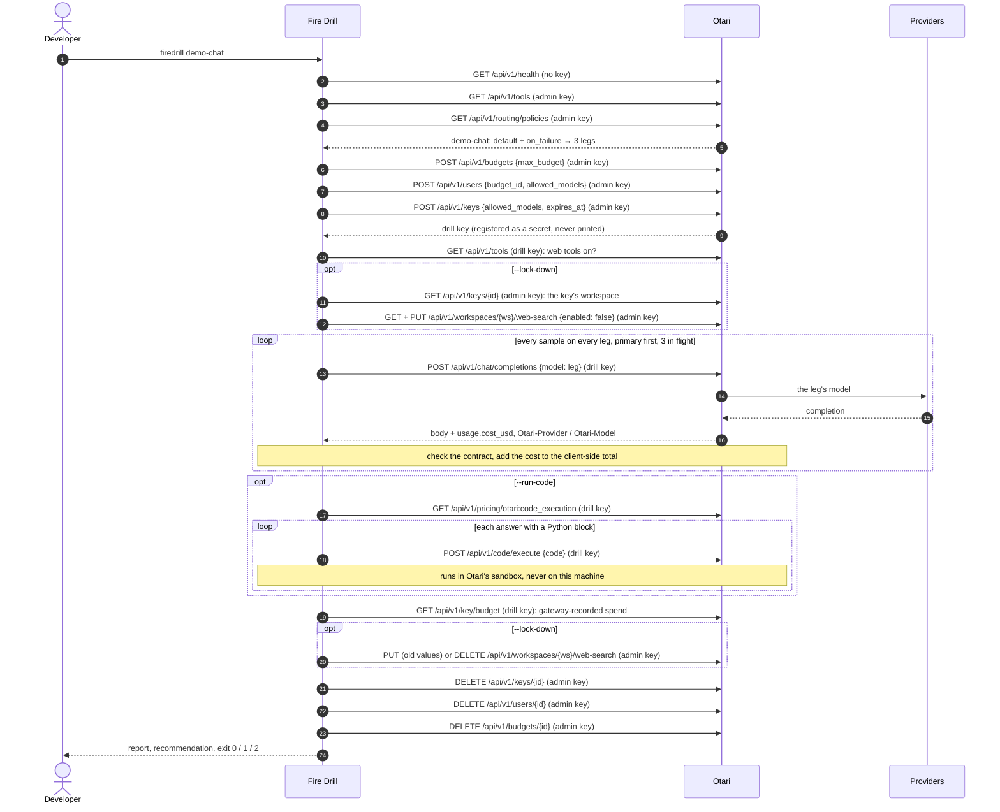

# Architecture

Fire Drill is one CLI process with no server and no database. It talks to exactly one
host, the Otari gateway, and every call is signed by one of three credentials: the
**user key** (your API key), the **admin key** (Otari's master key) or the **drill
key** (minted for one run, then deleted).

The SVG exports (`architecture-components.svg`, `architecture-sequence.svg`) are
rendered from the `.mmd` sources in this folder with
[mermaid-cli](https://github.com/mermaid-js/mermaid-cli):
`mmdc -i architecture-sequence.mmd -o architecture-sequence.svg -b white`.

## Components

| Component | File | Job |
| --- | --- | --- |
| CLI | `src/cli.ts`, `src/app.ts`, `src/options.ts` | Parses flags, validates them with zod, registers every key as a secret before anything can print. |
| Gateway client | `src/gateway/client.ts` | The only code that does network I/O. Signs each call by credential type, refuses redirects, emits one trace event per call. |
| Preflight | `src/gateway/tools.ts` | `GET /api/v1/health` and `GET /api/v1/tools`; every failure names its fix. |
| Leg resolver | `src/gateway/policy.ts` | Policy spec to ordered legs with roles; `--legs` and `--config` fallbacks. |
| Drill key | `src/gateway/keys.ts` | Mints budget, user and key; revokes them in reverse, idempotently. |
| Sample loader | `src/samples.ts`, `src/redact.ts` | Validates request bodies, strips `model`/`stream`/`user`/non-function tools, redacts secrets and emails. |
| Contract deriver | `src/contract/derive.ts` | Reads what the request already demands: a JSON schema, a JSON object, tool calls, or text. |
| Replayer | `src/replay.ts`, `src/budget.ts` | Primary first, 3 in flight, 60 s timeout, one retry; the client-side budget reserves before each send. |
| Checker | `src/contract/check.ts` | ajv validation, tool-call checks against the primary, refusals, truncation, served model. |
| Reporter | `src/report/*.ts`, `src/trace.ts` | Table or `--json`, grouped failures, recommendation, exit code, `--trace` lines. |
| Sandbox check | `src/sandbox.ts` | `--run-code`: the first Python block of each answer goes to `POST /api/v1/code/execute`, priced from `otari:code_execution`. |
| Web lock-down | `src/gateway/workspace.ts` | `--lock-down`: saves the workspace web policy, switches search and fetch off, restores it afterwards. |
| Recorder | `src/record.ts` | `--record [port]`: a 127.0.0.1 pass-through that writes sanitized chat completions for the alias to the samples file. |

## One drill, call by call

| # | Call | Signed by | Costs |
| --- | --- | --- | --- |
| 1 | `GET /api/v1/health` | no key | nothing |
| 2 | `GET /api/v1/tools` | user key, or admin key when no user key is given | nothing |
| 3 | `GET /api/v1/routing/policies` | admin key | nothing |
| 4 | `POST /api/v1/budgets` | admin key | nothing |
| 5 | `POST /api/v1/users` | admin key | nothing |
| 6 | `POST /api/v1/keys` | admin key | nothing |
| 7 | `GET /api/v1/tools` | drill key | nothing |
| 8 to n | `POST /api/v1/chat/completions`, once per sample per leg per run | drill key | the model's price, as `usage.cost_usd`, charged to the drill budget |
| opt | `GET /api/v1/keys/{id}`, then `GET` and `PUT /api/v1/workspaces/{ws}/web-search` (`--lock-down`) | admin key | nothing |
| opt | `GET /api/v1/pricing/otari:code_execution`, then one `POST /api/v1/code/execute` per answer with a Python block (`--run-code`) | drill key | the per-call sandbox price (the demo sets $0.001) |
| n+1 | `GET /api/v1/key/budget` | drill key | nothing |
| opt | `PUT` (old values) or `DELETE /api/v1/workspaces/{ws}/web-search` (`--lock-down`) | admin key | nothing |
| n+2 | `DELETE /api/v1/keys/{id}` | admin key | nothing |
| n+3 | `DELETE /api/v1/users/{id}` | admin key | nothing |
| n+4 | `DELETE /api/v1/budgets/{id}` | admin key | nothing |

`--trace` prints this list as it happens. A response without `usage.cost_usd` adds one
`GET /api/v1/usage/requests/{id}` (drill key) after the replays.
